# I-ITSM

[](https://github.com/Siddhant944/i-itsm/actions/workflows/ci.yml)

**Intelligent IT Service Management & Incident Resolution System** for a campus IT helpdesk.
Employees report problems; the system classifies, prioritises, assigns, tracks SLAs, escalates,
notifies and audits every step until the incident is verified and closed.

CS F213 / MAC F212 Object-Oriented Programming, Semester I 2026–27 · Group 15

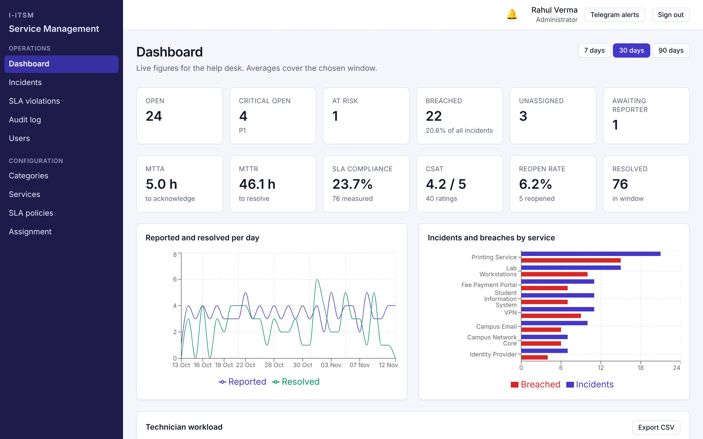

## Submission

- **Report:** [deliverables/15_OOP_S1_2026-2027_Project_Report.pdf](deliverables/15_OOP_S1_2026-2027_Project_Report.pdf)
- **Each item of the brief's Deliverables list**, with its chapter as its own PDF, the diagrams
  and the test results: [deliverables/](deliverables/README.md)
- **Demonstration video:** `15_OOP_S1_2026-2027_Project`, in the course's shared folder

## What it does

- **Three portals, five roles.** Employee, Technician (and Team Lead) and Admin (and IT Manager)
  portals that look visibly different, each with navigation to all of its screens. Each portal
  has a light and a dark theme (Light, Dark or System in the header); every text colour passes
  WCAG AA contrast in both, and axe-core checks every screen in both.
- **The full incident lifecycle.** Ten states and exactly the 20 legal transitions (State
  pattern); anything else is refused with a 409.
- **Automatic triage.** Category suggested by Gemini (or keyword rules) with its confidence and
  always overridable; priority from impact × urgency × business criticality with category floors;
  SLA targets per service tier; the best technician picked by a switchable strategy, with reasons.
- **SLA monitoring and escalation.** Warnings at 75 % of a target, recorded breaches, escalation
  up a Technician → Team Lead → Administrator → IT Manager chain, auto-close after 72 h, and a
  predictive risk estimate from history.
- **Duplicates and root causes.** Similar open incidents shown while the reporter types,
  confirmed duplicates linked, and incidents on dependent services traced to a likely root cause.
- **Report by voice or by chat.** Dictate the description (Web Speech API), or answer one
  question at a time in a chat that files the incident through the same rules as the form.
- **Live service health map.** Every campus service coloured by its open incidents and by the
  services it depends on, so an outage shows where it spreads.
- **Notifications.** In-app with live WebSocket updates, email, and Telegram for urgent events.
- **Accountability.** A hash-chained audit trail with an integrity check, 9-filter search with
  CSV export, and live dashboards.

Every external service (Gemini, SMTP, Telegram, Google Sign-In) is optional: without keys the app
uses its fallbacks — keyword rules, TF-IDF similarity, console email, password sign-in.

## Quick start

Needs [uv](https://docs.astral.sh/uv/), Node.js 22+ and git; uv installs Python 3.12 itself.

```bash
make setup
```

```bash
make demo-reset
```

Then open http://localhost:5173 and sign in with a demo account below. `demo-reset` builds a
fresh local SQLite database with the campus catalogue and 420 historical incidents, stages the
demo's starting points, and serves the API (http://127.0.0.1:8000, docs at `/docs`) and the web
app with the clock running ten times faster. For everyday development use `make seed` once and
then `make dev` (real-time clock, reload on save).

### Windows, without make

Install uv, Node.js and git:

```bash
powershell -ExecutionPolicy ByPass -c "irm https://astral.sh/uv/install.ps1 | iex"
```

```bash
winget install OpenJS.NodeJS.LTS Git.Git
```

Every `make <target>` is a thin wrapper over one cross-platform runner, so in PowerShell or cmd
run the same targets as:

```bash
uv run scripts/dev.py setup
```

```bash
uv run scripts/dev.py demo-reset
```

To run the app nothing else is needed: the database is a local SQLite file. The git hook also wants gitleaks
(`scoop install gitleaks`).

### Docker (API, web and PostgreSQL)

```bash
docker compose up --build
```

Then open http://localhost:8080. The API migrates the database before it serves. Deploying to
the cloud (Render and Neon free plans): [docs/DEPLOY.md](docs/DEPLOY.md).

## Demo accounts

`make seed` and `make demo-reset` create one account per role, all with the password `demo1234`:

| Email | Role | Portal |
| --- | --- | --- |
| `employee@campus.edu` | Employee | Employee |
| `technician@campus.edu` | Technician | Technician |
| `lead@campus.edu` | Team Lead | Technician |
| `admin@campus.edu` | Administrator | Admin |
| `manager@campus.edu` | IT Manager | Admin |

These are demo credentials for a seeded database. Each browser tab holds its own sign-in, so the
three portals can be open side by side as three different people.

## Screenshots

| Employee: reporting, with the AI suggestion and a possible duplicate | Technician: an incident with risk, suggested fix and root-cause hint |
|---|---|
| 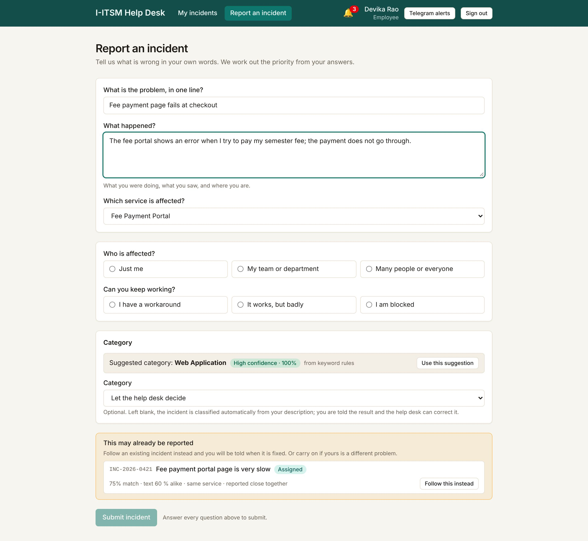 | 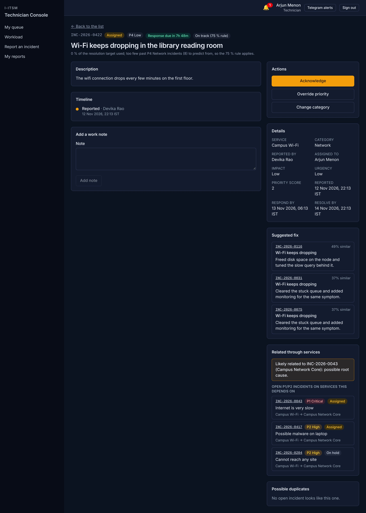 |
| **Technician: the queue with live SLA countdowns** | **Admin: 9-filter search with CSV export** |
| 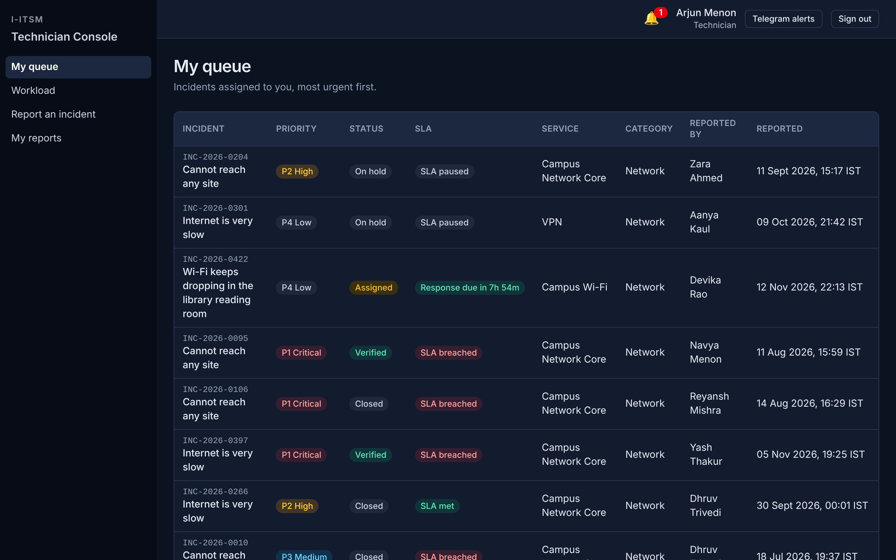 | 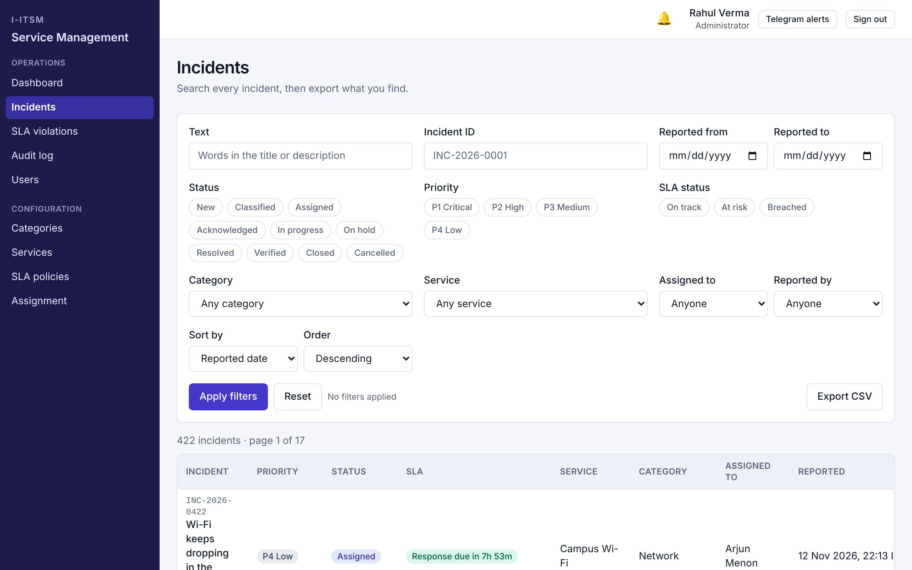 |
| **Admin: hash-chained audit log** | **Admin: SLA policies per tier and priority** |
| 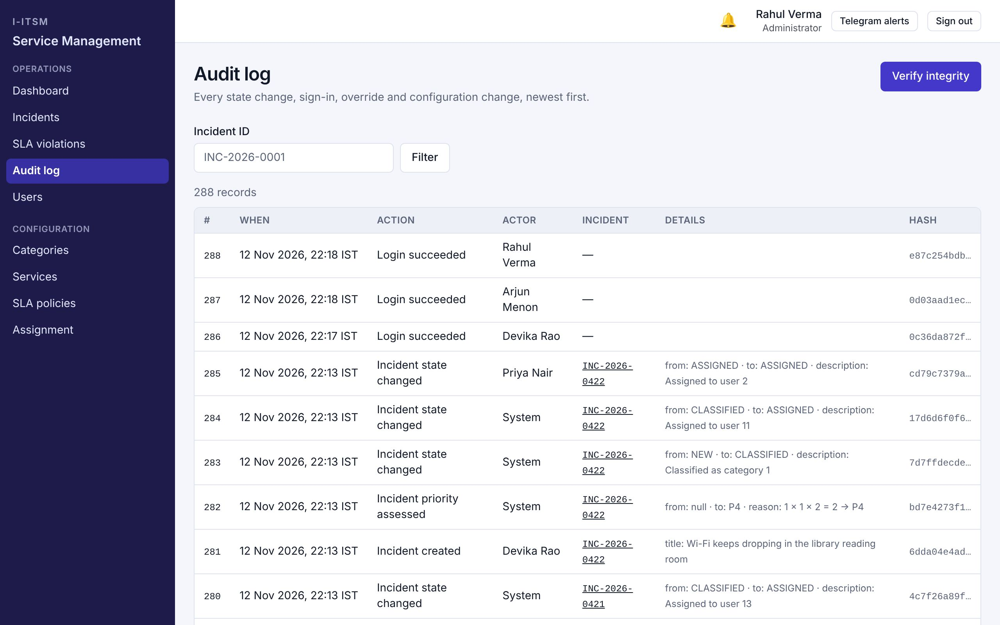 | 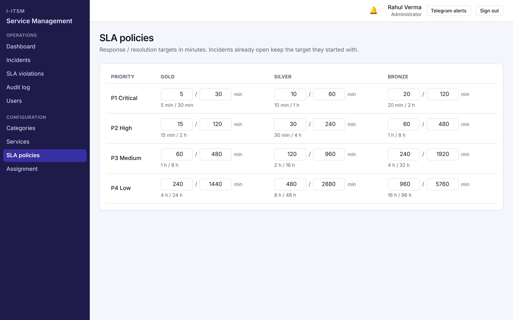 |
| **Admin: live service health map** | **Employee: report by chat** |
| 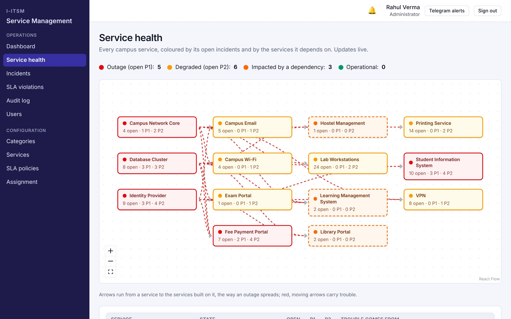 | 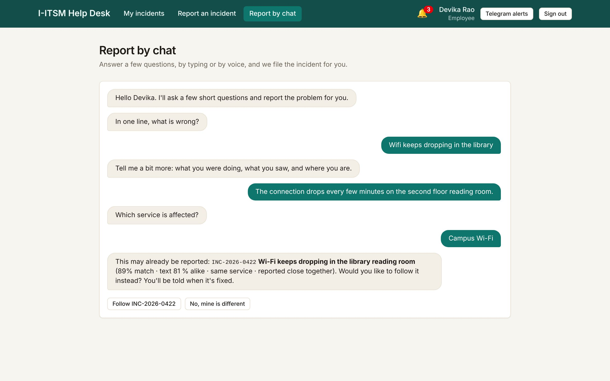 |
| **Dark theme: the admin dashboard** | **Light theme: the technician console** |
| 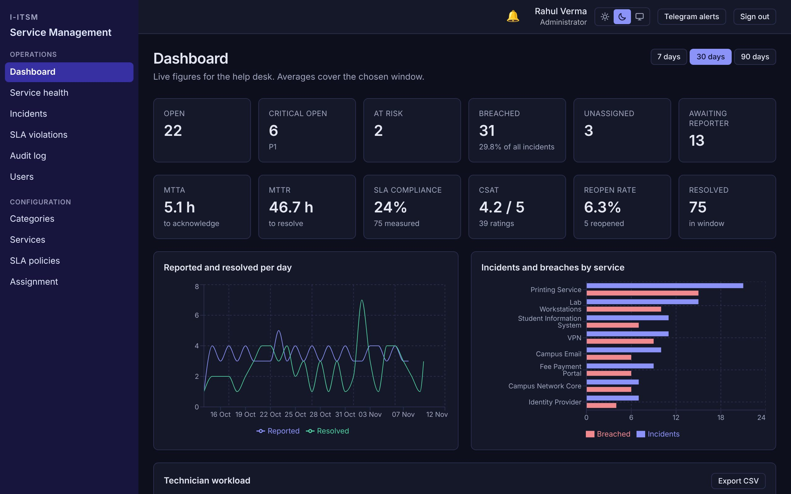 | 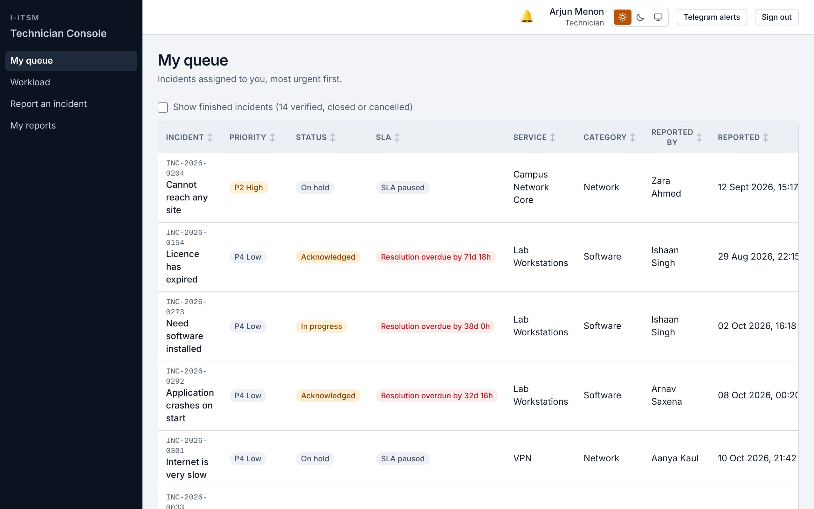 |
| **Dark theme: the employee report form** | |
| 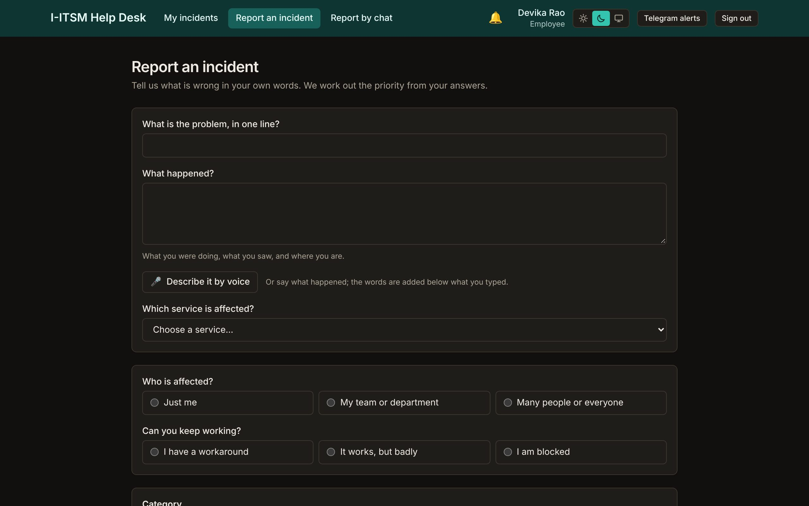 | |

## Commands

| Command | What it does |
|---|---|
| `make setup` | Install backend, frontend and e2e dependencies and the git hooks |
| `make dev` | Run the API and the web app with reload |
| `make migrate` | Bring the database at `DATABASE_URL` up to the latest Alembic migration |
| `make seed` | Migrate, then load the campus catalogue, the demo accounts and 420 historical incidents |
| `make demo-reset` | Wipe and reseed the local database, settle old outages, stage Workflows 1 and 2, then serve both apps on the ×10 clock; `cd e2e && npx playwright test -c demo` then rehearses the demo against it |
| `make test` | Backend (pytest) and frontend (Vitest) tests with coverage gates |
| `make verify` | Lint, format, types, layer contracts, generated-client check and all tests; must pass before every commit |
| `make e2e` | Playwright: the three workflows, live updates and an accessibility scan of every screen |
| `make gen-client` | Regenerate the typed TypeScript client from the API's OpenAPI document |
| `make diagrams` | Regenerate the code-derived UML and ER diagrams and render all of them |
| `make test-report` | Run the tests and write the documented cases' actual results into the report |
| `make report` | Build the report PDF (`report/build/main.pdf`) with tectonic |

Configuration lives in environment variables; copy `.env.example` to `.env` (never commit it).

`make diagrams` and `make report` also need Java 17+ (for PlantUML) and
[tectonic](https://tectonic-typesetting.github.io/); on Linux `scripts/cloud-setup.sh` installs
both into `tools/`. On Windows install a JDK (`winget install EclipseAdoptium.Temurin.21.JDK`) and
tectonic (`winget install TectonicProject.Tectonic`), download `plantuml.jar` and set
`PLANTUML_JAR` to its path. Or skip all of it: CI builds the PDF on any pull request labelled
`report` and attaches it to the run.

## Architecture

A layered modular monolith; every dependency points inward to a framework-free domain, and
import-linter fails the build if one does not
([diagram](docs/diagrams/architecture.svg)):

| Layer | Package | May import |
|---|---|---|
| API | `backend/app/api` | services, domain, core |
| Services | `backend/app/services` | domain, core |
| Domain | `backend/app/domain` | core only |
| Persistence / adapters | `backend/app/repositories`, `backend/app/adapters` | domain, core |
| Core | `backend/app/core` | — |

- **Backend:** Python 3.12, FastAPI, Pydantic v2, SQLAlchemy 2, Alembic, APScheduler, Google Gen AI SDK.
- **Frontend:** React, TypeScript (strict), Vite, Tailwind, TanStack Query, Recharts; it talks to the
  API only through a client generated from the OpenAPI document.
- **Data:** SQLite locally, PostgreSQL in Docker, CI and the cloud.
- **Design patterns:** State, Strategy, Template Method, Chain of Responsibility, Observer, Factory,
  Repository and Unit of Work, Adapter, Facade, Proxy (the AI fallback) — each class names its pattern in its docstring.

UML, ER and sequence diagrams: [docs/diagrams/](docs/diagrams/README.md).

## Tests

```bash
make test
```

About 1,100 backend tests (97 % coverage) and 106 frontend tests; every business rule BR-01 to
BR-10 has tests named after it, and time-dependent rules run on a fake clock. The backend suite
runs on SQLite by default; set `TEST_DATABASE_URL` to a PostgreSQL URL to run it there (CI runs
both). The 24 documented test cases and their results from the latest run:
[docs/testing/test-report.md](docs/testing/test-report.md).

## Documentation

- [Requirements](docs/source/OOP_S1_2026-2027_Project.pdf) · [Blueprint](docs/blueprint.md) ·
  [Plan](docs/PLAN.md) · [Progress](docs/PROGRESS.md) · [Decisions](docs/DECISIONS.md) ·
  [Demo script](docs/DEMO_SCRIPT.md) · [Deployment](docs/DEPLOY.md)
- The report: `report/` (`make report`)

## Team

| Member | Module |
|---|---|
| Tushar B (M1) | Domain and lifecycle |
| Siddhant L Pathak (M2) | Intelligence and SLA |
| Shri Krishna P (M3) | Platform |
| Ishaan S (M4) | Frontend and QA |
